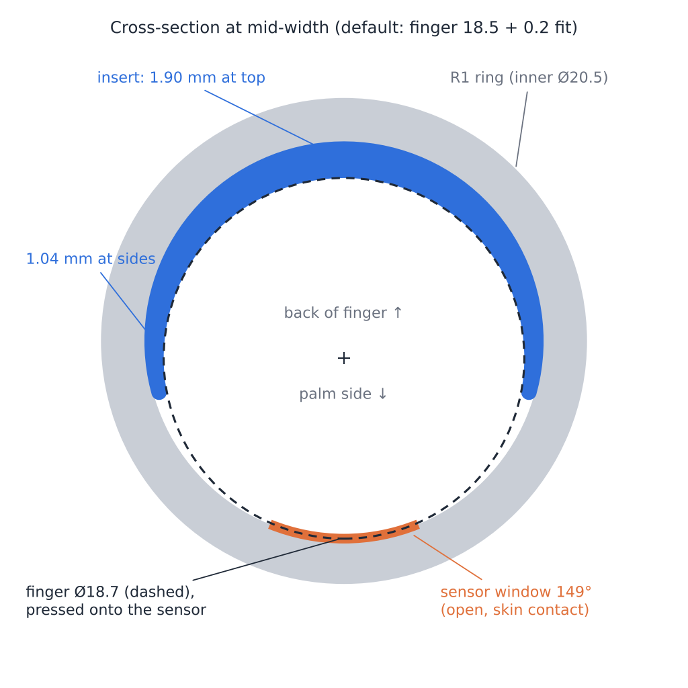
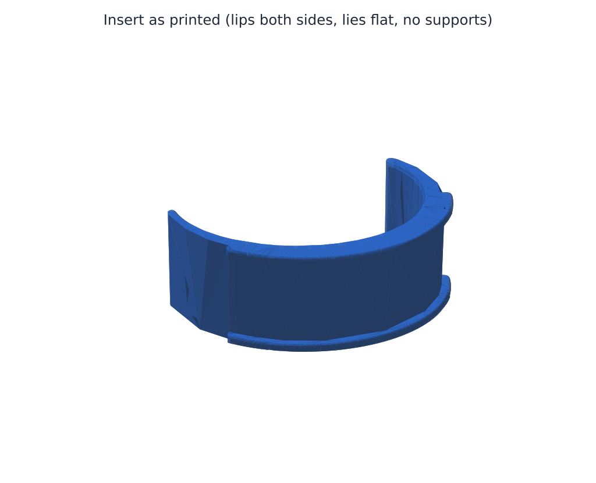

# Even R1 戒指调节垫片（Fusion 参数化脚本）

给 Even R1 戒指用的内衬垫片：戒指内径 20.5 mm、宽 6 mm，手指 18.5 mm，内侧下方有传感器。

## 为什么是"偏心 C 形"

戒指和手指之间只差 1 mm（每边）。如果做一圈均匀 1 mm 的内衬，手指会被整体托住、离开下方传感器约 1 mm，心率/血氧读数会变差。

所以垫片做成偏心的：

- **顶部（手背侧）最厚**，默认 1.90 mm，往两侧逐渐变薄（侧面 1.04 mm，尖端 0.8 mm，尖端是圆头）。
- **底部（手掌侧）完全留空**，默认开口 149°，手指被压向下方，直接贴住传感器。
- 内孔两侧边缘倒圆 0.45 mm，戴着不硌手。
- **侧唇**（默认两侧都有）：0.6 mm 厚的小翻边，扣住戒指两个侧面，垫片不会滑出。
- C 形外圈比戒指内径大 0.2 mm（过盈），靠弹力卡在戒指里，不会转动。

## 在 Fusion 里运行

1. 下载整个 `R1RingSizer` 文件夹（里面是 `R1RingSizer.py` 和 `R1RingSizer.manifest`，文件夹名要和 .py 同名）。
2. Fusion → **工具（Utilities）→ 附加模块（Add-Ins）→ 脚本和附加模块（Scripts and Add-Ins）**，快捷键 `Shift+S`。
3. 点 **+** →「从我的电脑添加脚本或附加模块」→ 选择 `R1RingSizer` 文件夹。
4. 选中 `R1RingSizer` → **运行（Run）**。
5. 脚本会新建一个设计并弹出参数对话框，改好尺寸后点 **生成**。结束时会弹窗显示实际壁厚、包角、窗口角度。
6. 想换尺寸就重新运行一次（每次都会新建设计，不会动你已打开的文件）。

导出：勾选对话框里的「导出 STL」会让你选文件夹；也可以在浏览器里右键实体 → 另存为网格（Save as Mesh），或用 Fusion 的 3D 打印功能直接发到 Bambu Studio。

## 参数说明

| 参数 | 默认 | 说明 |
|---|---|---|
| 戒指内径 | 20.5 mm | 按戒指**内径**理解。若你量的是别处，请改这里。 |
| 戒指宽度 | 6.0 mm | 两侧唇之间会自动加 0.2 mm 间隙。 |
| 手指直径 | 18.5 mm | 戒指所在位置的手指直径。 |
| 舒适余量 | 0.2 mm | 最终孔径 = 手指直径 + 余量（默认 18.7 mm）。太紧 +0.2，太松 −0.2。 |
| 尺寸数量 / 步进 | 1 / 0.2 mm | 设为 3 会并排生成 3 个尺寸（中间是你的尺寸，左小右大），适合一次打印试戴。 |
| 传感器窗口（最小） | 90° | 底部至少留空的角度。实际窗口由下面的"最小壁厚"决定，默认约 149°。 |
| 最小壁厚 | 0.8 mm | C 形尖端最薄处。小于 0.8 mm 用 0.4 喷嘴打印会很脆。 |
| 偏心 % | 100 | 100 = 手指贴紧传感器；0 = 均匀内衬（不推荐，会让传感器离开皮肤）。 |
| 侧唇 | 两侧 | TPU 建议两侧；PLA/PETG 建议"单侧"或"无"（硬材料装不进两侧翻边）。 |
| 侧唇厚度 / 覆盖 / 长度 | 0.6 / 0.8 mm / 120° | 侧唇只在顶部 120° 范围，不碰传感器，也尽量不挤旁边的手指。 |
| 夹紧过盈 | 0.2 mm | 垫片在戒指里会转就加到 0.3；装不进去就减到 0.1。 |
| 内边圆角 | 0.45 mm | 自动限制在最小壁厚的 60% 以内。 |

## 用 A1 mini 打印

**推荐材料：TPU 95A（如 Bambu TPU 95A HF）。** 最终孔径（18.7）比指关节小，硬塑料垫片很可能套不过指关节；TPU 能压缩变形，戴上和取下都容易，贴皮肤也更舒服。

- 喷嘴 0.4；TPU 走外挂料架直接进料（AMS lite 不支持 TPU）。
- 层高 0.12–0.16 mm（边缘圆角更平滑）。
- 墙数 3，填充 100%（零件几乎全是墙），**不需要支撑**，直接平放（脚本已按平放方向建模）。
- 速度用 TPU 预设即可；如尖端翘起，加 3 mm 裙边/brim。
- **接缝位置**：用接缝绘制把接缝放在 C 形的一个尖端，避免接缝落在顶部内表面硌手指。
- 单个约 0.4–0.5 g，几分钟就能打完。建议先打 3 个尺寸（`尺寸数量 = 3`）试戴。

仓库里也放了按默认参数生成的 STL（`stl/`，两侧唇、TPU 用），可以先直接切片试戴：

| 文件 | 适合手指 | 最终孔径 |
|---|---|---|
| `R1_sizer_18.5.stl` | 18.3 mm | 18.5 mm |
| `R1_sizer_18.7.stl` | **18.5 mm（默认）** | 18.7 mm |
| `R1_sizer_18.9.stl` | 18.7 mm | 18.9 mm |

## 安装到戒指上

1. 让 C 形开口对准戒指下方的传感器，厚的一侧在戒指顶部（手背侧）。
2. 先把一侧侧唇扣在戒指的一个侧面上，再把 C 形捏小一点，把另一侧侧唇从戒指另一边压过去。
3. 检查传感器完全露在开口里、没有被垫片尖端盖住。
4. R1 放上充电座前，先确认垫片不挡充电（我没有 R1 充电座的尺寸，挡的话充电时取下）。

## 验证与限制

- **我没法在这里运行 Fusion。** 为了尽量保证脚本一次就能跑通，我做了以下检查：
  - 用 CadQuery（另一个 CAD 内核）按完全相同的几何和建模步骤重建了零件，生成的是有效、封闭的实体（就是 `stl/` 里的文件）。
  - 截面实测：孔径 18.69 mm，孔心向传感器方向偏 0.90 mm，所以手指正好贴到戒指内壁（传感器）；顶部壁厚 1.90 mm，侧面 1.04 mm。
  - 用模拟的 Fusion API 跑通了"对话框 → 建模 → 导出"的完整流程（三种侧唇模式 × 单尺寸/多尺寸），每个草图都能形成封闭轮廓。
- 倒圆没有用 Fusion 的圆角（Fillet）功能，因为圆角要停在 C 形尖端，CAD 内核经常报错。脚本改用"旋转切除"刀具切出圆边，在两个内核里都更稳。
- 我不知道 R1 传感器的确切尺寸和位置，默认 149° 的开口应该足够，但请装上后目视确认。
- 运行出错的话，把弹窗里的错误信息发给我。

`tools/preview_cadquery.py` 是上面那个 CadQuery 校验/导出脚本（需要 `cadquery`），和 Fusion 脚本共用同一个 `compute_layout()`，数值一致。
