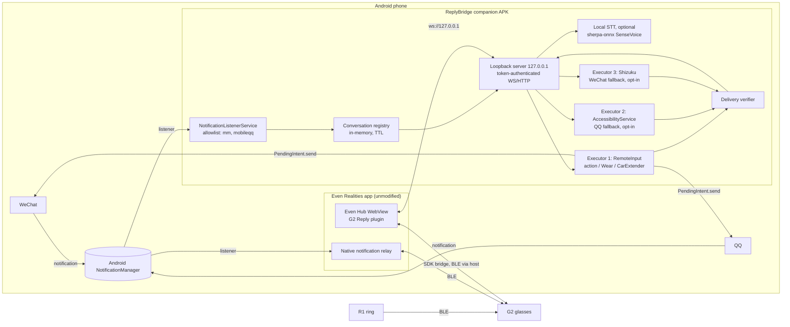
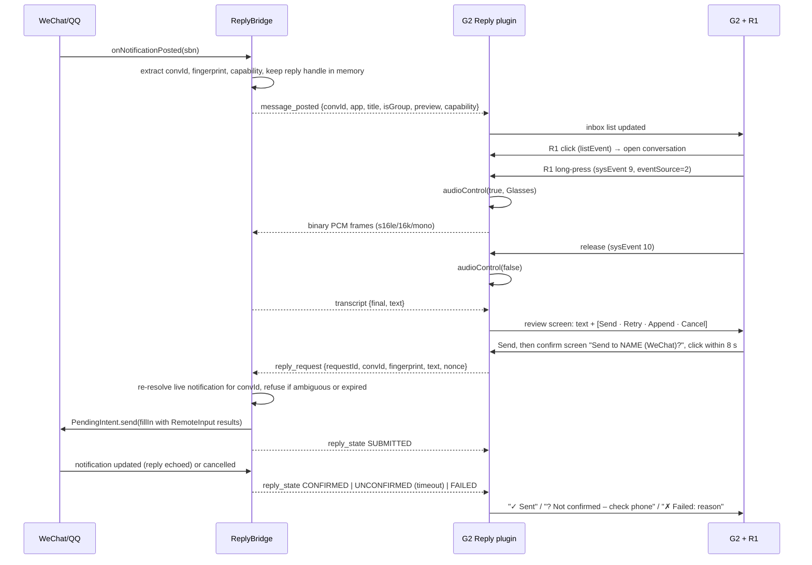

# Voice-to-Text Replies to WeChat and QQ with Even G2 + R1: Feasibility Research

| | |
|---|---|
| Date | 2026-10-13 |
| Scope | Hands-free reply to WeChat (`com.tencent.mm`) and QQ (`com.tencent.mobileqq`) notifications on Android, using Even G2 glasses, the R1 ring, and Even Hub |
| Type | Research and feasibility study. No application is implemented here. |
| Latest SDK checked | `@evenrealities/even_hub_sdk` **0.0.16** (published 2026-09-24, requires Even App ≥ 2.2.10) |

## How to read this report

Every major claim carries one of these evidence labels:

| Label | Meaning |
|---|---|
| **[V]** | Verified first-hand: I read the source, the type definitions, the decompressed or decoded package contents, or ran the code. |
| **[P]** | Primary source (official page or the original issue or forum post), read through search-engine extraction because this sandbox could not fetch the host directly. The link is given; re-read it before relying on exact wording. |
| **[C]** | Community or secondary source: open-source code by third parties, reviews, forum posts. |
| **[H]** | Hypothesis or inference. Not verified. |
| **[T]** | Must be tested on your physical phone, G2, or R1. |

Network note: this research environment could reach npm, GitHub (git and web) and GitLab (git). It could **not** reach `hub.evenrealities.com`, `support.evenrealities.com`, `play.google.com`, `developers.weixin.qq.com`, CSDN, Jianshu, Zhihu, or any APK mirror or Tencent CDN. For those hosts I used search-engine extraction only, and they are labeled [P] or [C]. No WeChat, QQ, or Even app APK could be downloaded, so no static analysis of those binaries was possible. Section F shows how to do that analysis on your Windows PC.

---

## A. Executive Conclusion

**Question:** Can Even G2 + R1 send voice-to-text replies to WeChat and QQ using only an Even Hub plugin, with no additional Android APK?

**Answer: Not currently feasible using public APIs.**

The deciding facts, all verified against SDK 0.0.16 and CLI 0.1.14 **[V]**:

1. **A plugin cannot read Android notifications.** The SDK has no notification method, event, or type. The manifest permission enum is exactly `g2-microphone`, `phone-microphone`, `album`, `location`, `network`, `camera`. There is no `notifications` permission. The Even app's own Notification Access is not delegated to plugins. The upstream feature request for a notification-relay API ([even-realities/everything-evenhub#24](https://github.com/even-realities/everything-evenhub/issues/24), opened 2026-08-09) is open with no staff response **[P]**.
2. **A plugin cannot invoke a notification action, a `RemoteInput`, a `PendingIntent`, or any Android `Intent`.** The bridge exposes 16 fixed host methods plus a generic `callEvenApp(method, params)` passthrough. None of the 16 relate to notifications or intents. The decoded SDK string table and the simulator binary contain no such handler names.
3. **Even if the plugin had both of the above, QQ and WeChat might still lack a usable reply handle.** No evidence shows QQ exposing a `RemoteInput`. WeChat's only documented reply handle is the Android Auto `CarExtender.UnreadConversation`, and car makers report it repeatedly returning `null` after WeChat updates (8.0.44, 8.0.50, 8.0.58) **[P]**.

**What is feasible:** a two-part system. An Even Hub plugin handles display, R1 input, microphone, and confirmation. A **minimal companion APK** holds Notification Access and performs the send. Its feasibility per app:

| App | Most likely working reply path | Status |
|---|---|---|
| **QQ** | AccessibilityService UI automation: open the chat from the notification's `contentIntent`, set the input text, press Send. The phone must be unlocked. | **Feasible with specific limitations.** QQ 9.3.50 exposes non-obfuscated accessibility nodes **[C]**. Whether RemoteInput exists must be tested **[T]**. |
| **WeChat** | First choice: `CarExtender.UnreadConversation` RemoteInput, which works with the phone locked and doesn't open WeChat, *if present* in your WeChat version. Fallback: Shizuku-assisted UI automation. | **Insufficient evidence — requires targeted testing** (Experiment 2). The fallback works per one closed-source project **[C]** but is fragile and carries the highest account-policy risk. |

Speech-to-text, R1 navigation, and on-glasses review and confirmation **are** achievable inside a plugin with public APIs:

- Glasses mic PCM s16le 16 kHz mono **[V]**.
- Long-press and release events for push-to-talk, since SDK 0.0.14 and 0.0.15 **[V]**.
- Ring vs temple source discrimination **[V]**.

The SDK has no speech-recognition API. Recognition must run in the cloud, in the companion APK, or in WASM inside the plugin **[V]**.

**Smallest decisive next step:** run Experiments 1 and 2 (Section F). They take about an hour with a USB cable and `adb`, plus a 60-line debug notification listener. They answer whether WeChat or QQ give you a lock-screen-safe RemoteInput reply handle. That single result decides whether the companion needs high-risk Accessibility or Shizuku code at all.

---

## B. Capability Matrix

Legend: ✅ works or verified · ⚠️ works with major caveats or unverified · ❌ not possible or contradicted by evidence · ❓ unknown, needs test

| Approach | Feasibility | QQ | WeChat | Extra install | Root | Background / locked phone | Reliability | Maintenance | Security / policy risk |
|---|---|---|---|---|---|---|---|---|---|
| **1. Pure Even Hub plugin** | ❌ No notification read API and no reply or intent API **[V]** | ❌ | ❌ | None | No | Runs only while the plugin is open. Headless WebView while the phone app is backgrounded **[V]** | n/a | Low | Low |
| **2. Existing official Even functionality** | ⚠️ Read-only. Native notifications show on G2 with "mark as read", but there is no reply **[P][C]**. "Add Agent" forwards Even AI's phone-side transcription to your HTTPS endpoint, but this is undocumented **[C]** | Display ✅ / reply ❌ | Display ✅ / reply ❌ | None (Add Agent needs your own HTTPS endpoint) | No | Native notifications ✅ | Display: high | Low (Add Agent may change without notice) | Low. Add Agent sends transcripts to your server. |
| **3. Android `RemoteInput` (sent by an app with Notification Access)** | ✅ API-level, works from a `NotificationListenerService` **[V]** (KDE Connect, Gadgetbridge, Watomatic do this) | ❓ No evidence of a reply action. gotmsg 2026 routes QQ to Accessibility **[C]** | ⚠️ Only via `CarExtender` (Android Auto). Version-dependent regressions **[P]** | Needs *some* app with notification access | No | ✅ No UI, works while locked (expected; verify **[T]**) | High *when present* | Low | Low–medium: Notification Access is sensitive. Same interface Android Auto and car head units use. |
| **4. Minimal companion APK** (NLS + loopback server + executors) | ✅ Transport and display are proven by Even Hub localhost bridges **[C]**. Reply quality depends on the executors below. | ⚠️ Via Accessibility | ⚠️ Via RemoteInput if present, else Shizuku | 1 sideloaded APK (install via `adb` to avoid "restricted settings" and verification prompts) | No | ✅ With battery-optimization exemption. UI fallbacks need an unlocked phone. | Medium | Medium | Medium. The loopback API must be authenticated. |
| **5. `AccessibilityService`** (UI automation) | ⚠️ | ✅ QQ 9.3.50 nodes readable and `ACTION_SET_TEXT` used **[C]** | ⚠️/❌ WeChat ≥ 8.0.52 obfuscates node content **[C]**. "New WeChat blocks ordinary accessibility input" **[C]**. Contradicting report: works when a real service is bound **[C]** | Companion with accessibility enabled | No | ❌ Phone must be unlocked. Opens the chat on screen. | Low–medium. Breaks with UI and version changes. | High | High. Full screen read and control. Account-policy risk. |
| **6. Shizuku** (ADB-shell-level helper) | ⚠️ | ✅ Possible | ✅ Claimed working by gotmsg v1.18.8 (closed source) **[C]** | Shizuku app + companion. Wireless-debugging restart after every reboot. | No (ADB-level) | ❌ Unlocked phone, or a stored-PIN auto-unlock, which is a security trade-off | Low–medium | High | **Highest.** ADB-level privileges plus stored PIN. Policy risk. |
| **7. Independent messaging client** | Official watch clients (WeChat Watch Edition) need a Tencent device license ❌. Unofficial PC clients (wxauto4 for WeChat PC 4.0.5, NapCat for QQNT) are technically possible ⚠️ | ⚠️ NapCat/OneBot on PC | ⚠️ wxauto4 UI automation on Windows WeChat | Always-on Windows PC. **No Android APK.** | No | PC must stay on and logged in | Low–medium | High | **High** policy risk. Tencent punishes automation tools (see §E.6). |

**Takeaways:**
- Approach 1 fails on a hard API gap, not on effort.
- Approach 7 is the only APK-free route that can actually reply, and it trades the APK for an always-on PC plus the worst policy risk.
- The recommended path is 4 (plugin + minimal companion), using 3 first and adding 5 for QQ and 6 for WeChat only if the experiments show they are needed.

---

## C. Smartwatch Architecture Comparison

### C.1 Three architectures that are often confused

| Architecture | How a reply is produced | Who must cooperate | Examples |
|---|---|---|---|
| **(a) Reply through the phone notification** | A phone-side companion (watch vendor app) holds `NotificationListenerService`. It mirrors the notification to the watch. When the user replies, it fills the source app's own `RemoteInput` and fires that app's `PendingIntent` on the phone. | Only the **source app**, which must attach a `RemoteInput` action (standard, `WearableExtender`, or `CarExtender`). | Wear OS bridging, Samsung Galaxy Wearable, Gadgetbridge, KDE Connect |
| **(b) Watch runs its own messaging client** | A WeChat client runs **on the watch**, logged in by QR or bound through phone WeChat. Messages and replies go through Tencent's servers or WeChat's device channel, not through Android notifications. | **Tencent** (licensing and partnership) plus the watch maker | WeChat Watch Edition (微信手表版) on Huawei, vivo, OPPO, Xiaomi; Apple Watch WeChat |
| **(c) Vendor companion as a reply bridge** | The vendor's phone app performs the reply with its *own* privileges: an SMS permission to send SMS, or system-level integration on the vendor's own phones. | The phone OS or vendor | Huawei and Xiaomi SMS quick reply, which sends SMS directly. Vendor-ROM integrations. |

### C.2 Per-ecosystem evidence

| Ecosystem | Mechanism for WeChat/QQ reply | Evidence | Reproducible by an Even Hub plugin alone? |
|---|---|---|---|
| **Wear OS** (Pixel Watch, Galaxy Watch 4+) | (a) The system bridges phone notifications. The reply fills the app's `RemoteInput` and the system sends the intent to the handheld app. The Reply button depends on the phone app attaching a reply action **[P]**. | Wear OS help: reply by swiping up on a bridged message notification and tapping Reply **[P]** ([support.google.com/wearos/answer/6056809](https://support.google.com/wearos/answer/6056809)). Legacy Android voice-input guide: the system attaches the dictated text to the action's intent and sends it to the handheld app **[P]**. GitHub issue (2019): WeChat notifications don't reach Wear OS while QQ's do **[C]** ([android/user-interface-samples#99](https://github.com/android/user-interface-samples/issues/99)). | No. It needs a NotificationListener on the phone. |
| **Samsung Galaxy Watch** | (a) Galaxy Wearable bridges notifications. Replying to third-party app notifications is supported where the app allows it. | Samsung support [ANS10002900](https://www.samsung.com/us/support/answer/ANS10002900/) **[P]**. Community reports of missing replies for some apps **[C]** ([eu.community.samsung.com](https://eu.community.samsung.com/t5/wearables/galaxy-watch-3-unable-to-reply-to-notifications-whatsapp/td-p/2057154)). | No |
| **Huawei Watch** (GT 3+, Watch 3/4/5) | WeChat: **(b)** WeChat Watch Edition. Requires HarmonyOS 2 or Android 9+, phone WeChat ≥ 8.0.24, bound via phone WeChat "Me → Settings → Devices → WeChat Watch Edition". Reply templates are configured in phone WeChat. SMS: **(c)** Huawei Health with SMS read/send permission. Other third-party apps: notification display. No documented generic reply was found **[H]**. | Huawei support [zh-cn15981855](https://consumer.huawei.com/cn/support/content/zh-cn15981855/) **[P]**. Tencent News 2022-09-23 **[C]** ([news.qq.com](https://news.qq.com/rain/a/20220923A09R3A00)). Huawei SMS-reply docs [zh-cn15842614](https://consumer.huawei.com/cn/support/content/zh-cn15842614/) **[P]**. | No. Needs a Tencent-licensed client. |
| **Xiaomi** (Watch 5 / Redmi Watch 5 / bands) | Notifications: Mi Fitness NotificationListener. SMS and call replies: **(c)**. WeChat on recent watches: **(b)** a WeChat watch app announced for Xiaomi watches. Mi Band 9 Pro community "quick apps" reportedly use WeChat's car (Android Auto) interface: **(a)** via `CarExtender` (forum claim). | Mi Band 6 firmware added SMS/call reply on Android **[C]** ([sina](https://finance.sina.com.cn/tech/2021-05-19/doc-ikmxzfmm3345505.shtml)). Watch WeChat app announcement **[C]** ([mydrivers](https://news.mydrivers.com/1/1063/1063156.htm)). Xiaomi Watch 5 firmware "optimised WeChat message receiving" **[C]** ([tech.ifeng.com](https://tech.ifeng.com/c/8wOZuzPEzx1)). bandbbs thread (forum, unverified) **[C]** ([bandbbs.cn/threads/14285](https://www.bandbbs.cn/threads/14285/)). | No |
| **vivo / OPPO** | **(b)** WeChat Watch Edition (vivo WATCH 2, 2022. OPPO Watch 3, 2023. OPPO Watch X with independent login, 2024). | Sina reprint "手表端回微信，刷朋友圈，手表厂商走了五步" **[C]** ([k.sina.cn](https://k.sina.cn/article_7857141524_1d452771401901vl2i.html)). Tencent News 2023-01-10 **[C]** ([news.qq.com](https://news.qq.com/rain/a/20230110A05VXA00)). OPPO Watch X independent login **[C]** ([news.qq.com](https://news.qq.com/rain/a/20240328A02U9300)). | No |
| **Kids' watches** | **(b)** WeChat kids-watch APK. The device maker must obtain a **WeChat device licence**. | Jiemodui report on WeChat's kids-watch access guide **[C]** ([jiemodui.com/N/127295.html](https://www.jiemodui.com/N/127295.html)) | No |

**Conclusions for G2:**
- **Every watch that genuinely replies to WeChat does so with a Tencent-licensed client (b),** not with a generic Android notification API. Even Realities has no such client, and an Even Hub plugin cannot become one.
- **Architecture (a) is reproducible for G2** only by adding a phone-side NotificationListener, i.e. a companion APK, and only for apps that ship a `RemoteInput`.
- **Architecture (c)** is irrelevant for WeChat and QQ, because there is no vendor privilege to "send a WeChat message".

---

## D. Verified API Findings

### D.1 Even Hub SDK 0.0.16: exact surface **[V]**

Source: npm tarball `@evenrealities/even_hub_sdk@0.0.16`, files `dist/index.d.ts` (1,535 lines) and `README.md`. The obfuscated `dist/index.js` was decoded: 1,139 unique strings, recovered by reversing the javascript-obfuscator base64 string-array encoding.

**Transport.** `window.flutter_inappwebview.callHandler('evenAppMessage', {type:'call_even_app_method', method, params})`. Host pushes arrive through `window._listenEvenAppMessage` with `type:'listen_even_app_data'`. The name `ListenEvenAppNotify` is this push channel, *not* Android notifications.

**`EvenAppMethod` (complete list, 16):**
- `getUserInfo`, `getGlassesInfo`, `setLocalStorage`, `getLocalStorage`
- `getAppLocation`, `startAppLocationUpdates`, `stopAppLocationUpdates`
- `pickImageFromAlbum`, `captureImageFromCamera`
- `createStartUpPageContainer`, `rebuildPageContainer`, `updateImageRawData`, `textContainerUpgrade`
- `audioControl`, `imuControl`, `shutDownPageContainer`

Plus `callEvenApp(method: string, params?)`, a generic passthrough with no documented extra methods.

**`BridgeEvent` (complete):** `evenAppBridgeReady`, `deviceStatusChanged`, `evenHubEvent`, `evenAppLaunchSource`, `appLocationChanged`.

**Decoded identifiers.** No string contains `RemoteInput`, `reply`, `intent`, `notification` (beyond the push-channel name), `speech`, or `recogni`. The simulator binary `@evenrealities/sim-linux-x64@0.9.5` likewise implements only the core methods **[V]**.

**Relevant capabilities that *do* exist:**

| Need | API | Version | Notes |
|---|---|---|---|
| Glasses mic | `audioControl(true, AudioInputSource.Glasses)` → `onEvenHubEvent(e => e.audioEvent.audioPcm)` | 0.0.11+ | PCM s16le, 16 kHz, mono, `Uint8Array`. Requires a successful `createStartUpPageContainer` first. |
| Phone mic | `AudioInputSource.Phone` | 0.0.11+ | No startup-page requirement |
| Speaker hint | `audioEvent.direction` (int16 or null), `audioEvent.speakerRole` (`self`/`other`/`unknown`) | 0.0.14+ | "App algorithm result, not firmware identity". Could help reject other people's speech while dictating **[H]**. |
| Push-to-talk | `OsEventTypeList.LONG_PRESS_EVENT = 9`, `LONG_PRESS_RELEASE_EVENT = 10` | 0.0.14+ (source-aware since 0.0.15) | Arrive as `sysEvent` with `eventSource` |
| Ring vs temple | `Sys_ItemEvent.eventSource`: `TOUCH_EVENT_FROM_GLASSES_R = 1`, `TOUCH_EVENT_FROM_RING = 2`, `TOUCH_EVENT_FROM_GLASSES_L = 3` | 0.0.9+ | Protobuf omits zero values; use `?? 0` |
| Other gestures | `CLICK_EVENT = 0`, `DOUBLE_CLICK_EVENT = 3`, `SCROLL_TOP_EVENT = 1`, `SCROLL_BOTTOM_EVENT = 2` | | Lists scroll natively, with no event per swipe |
| Contextual menu | `menuObject: MenuContainerProperty { menuItems: MenuItemProperty[] }` → `event.menuItemClickEvent.itemID` | 0.0.14+ | Max 10 items, name ≤ 32 UTF-8 bytes, `itemID` non-zero and unique |
| Text dimming | `textColor` 0–4 on text containers | 0.0.14+ | Use for "pending" vs "confirmed" states |
| Lifecycle | `FOREGROUND_ENTER_EVENT = 4`, `FOREGROUND_EXIT_EVENT = 5`, `ABNORMAL_EXIT_EVENT = 6`, `SYSTEM_EXIT_EVENT = 7` | | |
| Persistence | `setLocalStorage` / `getLocalStorage` (strings) | | Browser `localStorage`/IndexedDB are unreliable in the host WebView (per this repo's `device-features` skill) |
| Network | `network` permission with `whitelist: string[]` | | CLI schema accepts any string. Full CORS applies. |

**Not available:**
- Any notification API, intent API, or `openUrl` on Android.
- Speech recognition. Upstream request [#9](https://github.com/even-realities/everything-evenhub/issues/9) for `bridge.recognizeSpeech()` is open with no staff reply **[P]**.
- Background launch by an incoming message.
- Audio output.

**Repo note:** this repository's skills describe SDK 0.0.12. Long-press events, menus, `textColor`, and `speakerRole` from 0.0.14–0.0.16 are not yet documented in `plugins/everything-evenhub/skills/*`.

### D.2 Manifest and CLI **[V]**

- `@evenrealities/evenhub-cli@0.1.14` (`main.js`) defines `B_=["g2-microphone","phone-microphone","album","location","network","camera"]`. The `network` permission is `{name, desc (1–300), whitelist: string[]}`, with no URL-scheme validation in the schema.
- **Loopback entries are accepted in practice.** TeleGlance's packed `tele-glance-1.0.45.ehpk` whitelists `http://localhost:8787` and `http://127.0.0.1:8787` **[C]** ([app.json](https://github.com/jalatif/even-g2-tele-glance/blob/main/app.json)).
- Dev mode: `evenhub qr --url http://<ip>:<port>` makes the Even app load a plugin over plain HTTP from the LAN. That is first-party evidence that the host WebView allows cleartext page loads in dev mode.
- A packed `.ehpk` "cannot currently be opened or run directly. To test one on a device, upload it through the EvenHub site" (CLI README) **[V]**.
- Store rule (community): a root page's double-tap must call `shutDownPageContainer(1)` or submission is rejected **[C]** ([even-g2-notes page-lifecycle](https://github.com/nickustinov/even-g2-notes/blob/main/docs/page-lifecycle.md)).

### D.3 Official Even app functionality

- **Native notifications** **[P]**: the Even app needs Android Notification Access. G2 shows notifications, and you can "read new messages and mark them as read". Per-app filtering, Auto Display, and "Don't disturb other features". Transfer is phone→glasses over BLE, not cloud ([support article](https://support.evenrealities.com/hc/en-us/articles/14274501482639-Notification)).
- **No reply.** The Gizmodo review says "you cannot, however, respond to messages" **[C]** ([gizmodo.com](https://gizmodo.com/even-realities-even-g2-review-2000687632)). No release note found through 2026-10 mentions replies **[P]**.
- **Wire format** (reverse-engineered) **[C]**: phone notifications reach G2 as a JSON file on the file service (SID 0xC4/0xC5):
  ```
  {"android_notification":{"msg_id","action","app_identifier","title","subtitle","message","time_s","date","display_name"}}
  ```
  There is no reply field, and plugins never see this payload ([ithinkthisiscool/even-g2-protocol tests](https://github.com/ithinkthisiscool/even-g2-protocol)).
- **Input** **[P]**: long-pressing the temple or ring touchpad opens the system main menu, and the latest app adds "customizable long-press shortcuts". Whether a foreground plugin receives `LONG_PRESS_EVENT` before the system menu does is **[T]** (Experiment 6).
- **Even AI "Add Agent"** (undocumented, reverse-engineered) **[C]**:
  - Settings → Add Agent → *Name / URL / Token*.
  - On an Even AI invocation, the **phone app transcribes speech on-device** and POSTs `{"model":"openclaw","messages":[{"role":"user","content":"<transcript>"}]}` with `Authorization: Bearer <token>` to the URL, non-streaming. The lens shows `choices[0].message.content`.
  - Timeout is about 30 s. Only the latest utterance is sent.
  - The PoC says plain localhost (on a PC) won't work and uses an HTTPS tunnel ([kelvinsiew78/eveng2-agent-poc](https://github.com/kelvinsiew78/eveng2-agent-poc), MIT, 2026-09-17).
  - This is the **only official speech-to-text path**, and it is reachable only through Even AI's UI, not from a plugin.

### D.4 Android platform APIs (exact names)

| Purpose | API | Notes |
|---|---|---|
| Read other apps' notifications | [`NotificationListenerService`](https://developer.android.com/reference/android/service/notification/NotificationListenerService): `onNotificationPosted(StatusBarNotification)`, `getActiveNotifications()` | Requires the user to grant "Notification access". On Android 13+, sideloaded apps hit "restricted settings" unless installed via `adb` or a session installer. |
| Inline reply action | `Notification.Action.getRemoteInputs()` + `Notification.Action.actionIntent` | `Action.SEMANTIC_ACTION_REPLY` (API 28) |
| Wear reply actions | `NotificationCompat.WearableExtender(n).getActions()` (extras key `android.wearable.EXTENSIONS`) | Gadgetbridge uses only this path |
| Car reply | `NotificationCompat.CarExtender(n).getUnreadConversation()` → `getRemoteInput()`, `getReplyPendingIntent()`, `getReadPendingIntent()`, `getParticipants()` (extras key `android.car.EXTENSIONS`) | [Deprecated](https://developer.android.com/reference/androidx/core/app/NotificationCompat.CarExtender.UnreadConversation.Builder) in androidx core 1.3.0 in favour of MessagingStyle + reply action, but still populated by some apps |
| Fill the reply | `RemoteInput.addResultsToIntent(inputs, fillIn, bundle)`, `RemoteInput.setResultsSource(fillIn, RemoteInput.SOURCE_FREE_FORM_INPUT)` (API 28), then `PendingIntent.send(context, 0, fillIn)` | Fill-in extras are applied only if the source app made the `PendingIntent` `FLAG_MUTABLE`, which Android 12+ requires for RemoteInput |
| Conversation identity | `sbn.getKey()`, `sbn.getId()/getTag()`, `Notification.getShortcutId()` (API 26), `EXTRA_CONVERSATION_TITLE`, `EXTRA_IS_GROUP_CONVERSATION` (API 28), `EXTRA_MESSAGES` (MessagingStyle) | Which ones WeChat and QQ populate is **[T]** |
| Reply echo (delivery hint) | `Notification.EXTRA_REMOTE_INPUT_HISTORY`, updated `EXTRA_MESSAGES` | Used for the "confirmed" state (§E.5) |
| Open chat for UI fallback | `Notification.contentIntent.send()` | Android 14+ background-activity-launch rules apply. Services bound by the system such as `AccessibilityService` are a documented exemption; `NotificationListenerService` is not in that list ([background-starts](https://developer.android.com/guide/components/activities/background-starts)) **[P]** |
| Speech recognition (native) | `SpeechRecognizer.createOnDeviceSpeechRecognizer()` (API 31), `RecognizerIntent.EXTRA_AUDIO_SOURCE` + `EXTRA_AUDIO_SOURCE_ENCODING/CHANNEL_COUNT/SAMPLING_RATE` (API 33) for feeding external PCM ([RecognizerIntent](https://developer.android.com/reference/android/speech/RecognizerIntent)) | Whether the on-device recognizer honours `EXTRA_AUDIO_SOURCE` on your phone is **[T]** |
| Web Speech API | `SpeechRecognition` in Android WebView | Deliberately disabled in WebView ([crbug 41172064](https://issues.chromium.org/41172064)) **[P]**. It also cannot consume the bridge's PCM. **Not usable.** |

`adb shell dumpsys notification --noredact` prints action titles, `PendingIntent`s, all extras keys (so `android.car.EXTENSIONS` and `android.wearable.EXTENSIONS` are visible), and the template. It does **not** print RemoteInputs. Verified in AOSP `NotificationRecord.dumpNotification()` **[V]**. That makes it a fast triage tool, but a listener is needed for a definitive answer.

### D.5 WeChat and QQ notification evidence

**WeChat (`com.tencent.mm`)**

| Claim | Evidence | Label |
|---|---|---|
| No user-visible inline "Reply" in the notification shade | 2020 press: "微信没有通知栏快捷回复的功能" ([sina](https://tech.sina.cn/2020-07-03/detail-iirczymm0224731.d.html)). V2EX 2020 ([t/708561](https://www.v2ex.com/t/708561)). | [C], dated |
| Notifications carry a `CarExtender.UnreadConversation` with reply `RemoteInput` used by Android Auto and car head units | CSDN 2020 "利用NotificationListenerService和Android Auto自动回复微信消息" ([link](https://blog.csdn.net/hubinbin595959/article/details/107088826)). WeChat Open Community threads from car integrators (below). | [P]/[C] |
| That handle **regressed** in several versions | **8.0.44 (beta):** "安卓车机设备安装最新版微信后，车载设备上的回复功能全部失效", `getUnreadConversation()` returns no instance. A user adds Android Auto replies broke too ([doc/0008a8597e…](https://developers.weixin.qq.com/community/minihome/doc/0008a8597e08204a4ab04cd6a6b400)). **8.0.50:** same, new `mCachedinfo=null` field ([doc/0002aef77f…](https://developers.weixin.qq.com/community/develop/doc/0002aef77f0ce02f5eb1c5f6966800)). **8.0.58:** car-unit notification data reads `NULL`, "8.0.57 没有这个问题" ([doc/000ce443d0…](https://developers.weixin.qq.com/community/minihome/doc/000ce443d04f20ceae332177c6b800)). No Tencent fix confirmation found. | [P] (search-extracted) |
| Whether the CarExtender appears on a normal phone without Android Auto installed or connected | No evidence either way | **[T]** |
| Accessibility hostility | Node content obfuscated from 8.0.52+ ([CSDN 2025](https://blog.csdn.net/weixin_37496178/article/details/146541873)). gotmsg: "微信新版会屏蔽普通无障碍输入，因此微信回复必须使用 Shizuku". jev-chat-jarvis (MIT, 2026-10) hard-blocks `com.tencent.mm` because it "protect[s] content against screen reading". DroidHarness PR (2026-10, HyperOS/Android 16): WeChat returns its tree only to a *bound* AccessibilityService, and `ACTION_SET_TEXT` of Chinese worked. | [C], mixed |

**QQ (`com.tencent.mobileqq`)**

| Claim | Evidence | Label |
|---|---|---|
| No inline reply action | V2EX 2020 ("QQ和微信安卓版不支持通知栏回复"). gotmsg 2026 sends QQ through Accessibility, which it uses "只有通知本身没有 Android 快捷回复时". | [C] |
| Accessibility tree is usable | jev-chat-jarvis `ChatAppAdapter.kt`: "Nodes are NOT obfuscated (verified on QQ 9.3.50 / Xiaomi 14)". Input id `com.tencent.mobileqq:id/input`, bubble `id/mjn`. | [C] (version-specific) |
| Car or Wear extenders | No evidence | **[T]** |

**Content visibility prerequisite [H][T].** If WeChat's "新消息通知 → 通知显示消息详情" (or QQ's equivalent "通知显示消息内容") is off, notifications contain no sender or text.

---

## E. Recommended Architecture

### E.1 Summary

**Plugin "G2 Reply" (Even Hub, TypeScript)** + **companion "ReplyBridge" (Kotlin APK, minimal)**, talking over an authenticated **loopback** channel (`127.0.0.1`), with **speech recognition in the companion** (local) or a cloud provider for the first PoC.

This loopback pattern already ships in the Even Hub community:
- takemotions-media-bridge serves `http://127.0.0.1:8766`, MIT, "reachable even with the screen off" **[C]**.
- appsbridge serves `ws://127.0.0.1:7071` and `http://127.0.0.1:7070` **[C]**.

### E.2 Component diagram



### E.3 Data flow (happy path, RemoteInput available)



### E.4 Loopback protocol sketch (JSON over WebSocket, binary frames for audio)

```text
→ hello            {token, client:"g2-reply", proto:1}
← snapshot         {conversations:[{convId, app:"wechat"|"qq", title, isGroup, lastSender,
                     preview, postTime, capability:"remote_input"|"accessibility"|"shizuku"|"none",
                     fingerprint, expiresAt}]}
← message_posted / message_removed {convId, ...}
→ stt_start        {requestId, lang:"auto"|"zh"|"ja"|"en"}   then binary PCM frames
→ stt_stop         {requestId}
← stt_result       {requestId, text, final}
→ reply_request    {requestId, convId, fingerprint, text, confirmNonce}
← reply_state      {requestId, state:"validating"|"submitted"|"confirmed"|"unconfirmed"|"failed", reason}
```

Plugin `app.json` additions:
- `network.whitelist`: `http://127.0.0.1:<port>` and `ws://127.0.0.1:<port>`. Whether the `ws://` scheme must be listed separately is **[T]**. Fall back to HTTP + SSE (`EventSource`) if WebSocket is blocked.
- `g2-microphone`.

### E.5 Interaction model (only gestures that exist in SDK 0.0.16)

| Screen | Container with `isEventCapture` | Gesture → action |
|---|---|---|
| **Inbox** (root) | List (≤ 20 items, ≤ 64 chars each): `[微] 张三: 晚上…` / `[Q] 群名·李四: …` | Swipe: native scroll, no event. **Click**: open conversation (`listEvent.currentSelectItemIndex ?? 0`). **Double-click**: `shutDownPageContainer(1)`, which store rules require on the root page. |
| **Message** | Text (full text, sender, group marker, age) | **Click**: go to Record. **Double-click**: back to Inbox. Swipe: scroll the text. |
| **Record** | Text ("● 正在录音 / Recording…" + live partial transcript, debounced ≥ 120 ms) | **Long-press (9)**: start mic. **Release (10)**: stop (push-to-talk). Fallback if the system menu steals long-press: **Click** toggles start/stop. **Double-click**: cancel. |
| **Review** | Text (transcript) + List: `发送 Send` / `重录 Retry` / `追加 Append` / `取消 Cancel` | **Click** an item. **Double-click**: back to Message. Retry replaces the text, Append dictates more, Cancel discards. |
| **Confirm** | Text "发送给 张三 (微信)?" + List `确认 Confirm` / `返回 Back` | **Click Confirm within 8 s**. Ignore input for 400 ms after each screen change. Optionally accept Confirm **only when `eventSource === 2` (ring)**. |
| **Result** | Text, `textColor` 4 for confirmed, 2 for unconfirmed | **Click**: back to Inbox |

- **Correction.** G2 offers no text editing, so correction means Retry, Append, or canned quick replies offered as list items, such as "好的" or "稍后回复".
- **Contextual menu.** `menuObject` could hold Cancel and Back. How the user summons it, and whether that conflicts with long-press push-to-talk, is **[T]**.
- **Event hygiene** **[C]**:
  - Dedupe duplicate `sysEvent`s within about 600 ms (firmware double-fires).
  - Handle CLICK arriving with `eventType` undefined.
  - Latch "startup was called" rather than "startup succeeded".

### E.6 Security, reliability and policy design

**Wrong conversation**
- The companion never trusts a cached `PendingIntent` blindly.
- At send time it re-resolves the *current* active notification for `convId` and checks the fingerprint (package + conversation title + `isGroup` + shortcutId where present).
- It refuses on mismatch, or when two live conversations share a title.
- The confirm screen always shows app, conversation name, and a **GROUP** marker.

**Group vs private chat**
- Use `EXTRA_IS_GROUP_CONVERSATION` if populated. Otherwise use a per-app heuristic, such as a `sender: text` body pattern, and record it as low-confidence.
- Show "→ group 群名" explicitly. Optionally require a second confirm for groups.

**Multiple, replaced, or expired notifications**
- Key by `sbn.key` but track by `convId`, and skip group summaries.
- Remember the latest `postTime`, dedupe on (key, postTime, hash(text)), and keep handles in memory only with a TTL (e.g. 10 min).
- If the user dismisses the notification or reads it on the phone, the RemoteInput handle is gone. Report `FAILED: notification gone`, and never fall back silently to UI automation.

**Delivery states (never claim "sent" from `PendingIntent.send()`)**
- **`SUBMITTED`**: the intent was accepted.
- **`CONFIRMED`**: within about 10 s the source app updates the same conversation notification so that `EXTRA_REMOTE_INPUT_HISTORY` or the last `EXTRA_MESSAGES` entry from self contains the text. For the Accessibility path, the input box is empty and the newest outgoing bubble matches the text.
- **`UNCONFIRMED`**: no echo within the timeout. Show "? 未确认 — 请在手机上查看". Do not retry automatically, because that risks a duplicate send.
- **`FAILED`**: `CanceledException`, handle missing, locked phone for UI paths, or draft present in the input box (gotmsg's rule: never overwrite a draft).

**Lock screen**
- RemoteInput needs no UI and is expected to work while locked **[T]**.
- Accessibility and Shizuku paths need an unlocked phone.
- gotmsg's PIN auto-unlock stores your PIN. **Not recommended.**

**Bluetooth drop or WebView suspension**
- No queued sends. A confirm is valid only for its `confirmNonce` and 8 s.
- After reconnect, show state from the companion and never re-issue.
- Snapshot only the UI state (screen, selected `convId`, draft text) via `setBackgroundState`. See this repo's `background-state` skill.

**Android background limits**
- The NLS is system-bound. Run the loopback server in a foreground service (Android 14 needs an FGS type).
- Ask for a battery-optimization exemption and vendor "autostart" on MIUI/HyperOS, ColorOS, etc.

**Accidental gestures**
- Two-step confirm, a timeout, a 400 ms input guard, and an optional ring-only confirm.

**Privacy**
- Allowlist only `com.tencent.mm` and `com.tencent.mobileqq`.
- No disk persistence of message text, and log hashes and lengths only.
- Bind to `127.0.0.1` only. Require a pairing token: the companion shows a 6–8 digit code, the plugin stores the derived token with `setLocalStorage`.
- Check `Origin`, and rate-limit `reply_request`.
- Any app on the phone can reach loopback ports. takemotions-gps-bridge's README warns about exactly this.

**STT privacy**
- Local recognition keeps audio on the phone. Cloud STT sends voice to a third party.
- The Even AI Add Agent path sends transcripts to your endpoint.

**Account and policy risk**
- WeChat publicly penalises "外挂" (unauthorized third-party tools), including auto-reply and group-control tools, under the 《腾讯微信软件许可及服务协议》 and 《微信个人账号使用规范》, with feature limits up to bans. Announcements were reported in 2019 and again in July 2025 **[C]** ([ithome](https://www.ithome.com/0/461/207.htm), [ithome](https://www.ithome.com/0/867/135.htm)).
- **Risk ranking (lowest to highest):**
  1. RemoteInput / CarExtender: the interface Android Auto and car makers use.
  2. Accessibility.
  3. Shizuku input injection.
  4. PC automation clients.
  5. Hooks (Xposed/LSPosed). **Excluded.**
- Keep a human confirmation on every send, low volume, no auto-replies.
- QQ's own licence terms were not verified here; assume similar.

**Distribution**
- Sideload the companion via `adb install` from your Windows PC. ADB is reported exempt from Google's developer-verification enforcement, which started 2026-09-30 in BR/ID/SG/TH and goes global in 2027 **[C]** ([Android Developers blog](https://developer.android.com/blog/posts/android-developer-verification-rolling-out-to-all-developers-on-play-console-and-android-developer-console), [Android Authority](https://www.androidauthority.com/android-sideloading-changes-timeline-3679204/)).
- Installing via `adb` also avoids Android 13+ "restricted settings" for Notification and Accessibility access.

### E.7 Speech-to-text options

| Option | Where | zh / ja | Latency / cost | Verdict |
|---|---|---|---|---|
| **sherpa-onnx + SenseVoice** (Apache-2.0) | Companion APK (Android AAR) | SenseVoice lists zh, en, ja, ko, yue **[C]** ([k2-fsa/sherpa-onnx](https://github.com/k2-fsa/sherpa-onnx)). VAD-segmented, not streaming. | On-device and free. Model size and phone CPU load are **[T]**. | **Recommended for production.** Audio never leaves the phone, and the companion exists anyway. |
| Android `SpeechRecognizer` + `EXTRA_AUDIO_SOURCE` | Companion | Depends on the installed recognition service (Google or vendor) | On-device where available | Cheap to try (Exp. 5b). Behaviour varies by OEM **[T]**. |
| Cloud streaming STT (pattern: [even-voice-shim](https://github.com/tntpsu/even-voice-shim), MIT; ASR template) | Plugin → your Worker → provider | Provider-dependent. Verify zh/ja per provider. | About 1.0–1.4 s for short utterances in even-voice-shim's measurements **[C]**. Pay per second. | **Fastest PoC.** Needs a `network` whitelist and a key proxy. |
| WASM (sherpa-onnx wasm / whisper) | Plugin WebView | SenseVoice wasm demo exists **[C]** | Heavy download into a WebView whose storage is unreliable | Not recommended |
| Web Speech API | Plugin WebView | n/a | n/a | **Unavailable** in Android WebView |
| Even AI "Add Agent" | Official app | Even AI's own ASR | No plugin. About 30 s timeout. | Alternative UX (§E.8), undocumented |

### E.8 Alternative UX with no plugin (exploratory)

The companion exposes an HTTPS endpoint registered as an Even AI "Add Agent". You long-press to talk to Even AI and say, for example, "回复张三 我十分钟后到". Even AI's own ASR transcribes it. The companion answers "发送给 张三 (微信)：我十分钟后到？说'确认'", and you say "确认" to send.

- **Pros:** official transcription, no STT code, no plugin.
- **Cons:**
  - Undocumented protocol.
  - Stateless requests with only the latest utterance, so confirmation state lives in the companion.
  - The PoC says plain localhost won't work, so an HTTPS tunnel or LAN endpoint may be needed **[T]**.
  - No R1 list navigation.
  - The transcript passes through your endpoint.

Worth one experiment (Exp. 5c). Not the primary design.

---

## F. Proof-of-Concept Plan and Experiments

### F.1 Which experiments need what

| Experiment | Where | Status |
|---|---|---|
| E0: SDK and CLI surface audit (notification, intent, and STT APIs) | Cloud | **Done in this report** (§D.1–D.2). No such APIs exist. |
| E0b: Open-source reply-mechanism review | Cloud | **Done** (§G) |
| E2s: Static scan of your WeChat and QQ APKs for `CarExtender` / `RemoteInput` usage | **Windows PC**, no phone needed | Not possible here: APK hosts were blocked from this sandbox |
| E1–E8 | **Your phone, G2, and R1** | Pending |

### F.2 Ordered plan (smallest decisive step first)

| Phase | Goal | Exit criterion |
|---|---|---|
| **P0** (≈ 30 min, PC + USB) | Triage WeChat and QQ notification structure with `dumpsys` (E1a/E2a) | Know whether `android.car.EXTENSIONS` / `android.wearable.EXTENSIONS` / action titles exist |
| **P1** (≈ 1 h) | 60-line debug `NotificationListenerService` ("NotifInspect", Appendix 1) (E1b/E2b) | Definitive per-app table of RemoteInput handles |
| **P2** (≈ 1 h) | Send one reply through each handle found (E1c/E2c) to a test contact or test group, phone locked and unlocked | **This decides the companion's scope:** RemoteInput only, or with UI fallbacks |
| **P3** (≈ 1 h, dev mode QR) | Probe plugin (Appendix 2): host surface, loopback reachability, mic, gestures (E3–E6) | Loopback fetch/WS works from the plugin, long-press reaches the plugin, PCM arrives |
| **P4** | Companion v0: NLS registry + loopback API + RemoteInput executor + verifier. Plugin v0: inbox, message, confirm, result (typed canned replies, no STT yet). | E8 minus STT passes |
| **P5** | Add STT: cloud (quick) or companion sherpa-onnx (target) | Japanese and Chinese dictation acceptable on 20 test phrases |
| **P6** (only if P2 failed for an app) | Opt-in fallbacks: QQ Accessibility executor, WeChat Shizuku executor, each behind a per-app switch | E8 passes with an unlocked phone. Policy risk accepted explicitly. |
| **P7** | Robustness: lock screen, BLE drop, duplicates, group chats (E7 + §E.6 checklist) | All negative tests produce FAILED or UNCONFIRMED, never a false CONFIRMED |

### F.3 Experiments

**Experiment 1 — Do QQ notifications expose a reply handle?**
- **Prerequisites:**
  - Android phone with USB debugging, plus Windows PC with platform-tools (`adb`).
  - QQ logged in with "show message content in notifications" on.
  - A second account to send test messages: one private chat and one group.
  - Record QQ version (Settings → About), Android version, and ROM.
- **Procedure:**
  - **1a.** Receive a private message with QQ in background and the screen on, then run `adb shell dumpsys notification --noredact > qq_private.txt`. Repeat for a group message and with the screen locked. In the record with `pkg=com.tencent.mobileqq`, inspect `actions={…}`, extras keys (`android.car.EXTENSIONS`, `android.wearable.EXTENSIONS`, `android.template`, `android.messages`, `android.isGroupConversation`, `android.conversationTitle`), and the `shortcut=` value in the `Notification(...)` line.
  - **1b.** Install NotifInspect (Appendix 1) via `adb install`, grant Notification access, and repeat 1a. Read `adb logcat -s NotifInspect`.
  - **1c.** If any handle with RemoteInput exists, trigger NotifInspect's test reply ("[test] 1c") to the test account.
- **Expected evidence:** a JSON line per notification listing `actions[].remoteInputs`, `wearActions`, `car.hasRemoteInput`, `mutable`, `template`, `isGroupConversation`.
- **Pass/fail:**
  - Pass: at least one handle with a free-form RemoteInput **and** a mutable `PendingIntent`, and 1c's text appears in the chat from your account.
  - Fail: no handle, or a handle exists but the message never arrives.
- **Version dependencies:** QQ version (track per release), Android ≥ 12 for `isMutable` and `isActivity`, ROM notification tweaks.
- **Conclusion:**
  - Pass: QQ replies can be lock-screen-safe with no Accessibility.
  - Fail: QQ needs the Accessibility executor, so the phone must be unlocked.

**Experiment 2 — Do WeChat notifications expose a reply handle?**
- **Prerequisites:** as E1, with WeChat (record version and source: weixin.qq.com or Google Play) and "通知显示消息详情" on. Optionally a second run with the Android Auto app installed.
- **Procedure:**
  - Same as E1 (2a dumpsys, 2b NotifInspect, 2c test reply), for private and group chats.
  - Repeat 2b with and without Android Auto installed. If none is found, also repeat after any WeChat update.
  - **2s (PC, optional):** open the WeChat APK in JADX and search for `android.car.EXTENSIONS`, `CarExtender`, `UnreadConversation`, `RemoteInput`. Run `aapt2 dump xmltree` on the manifest for `com.google.android.gms.car.application`. This is static evidence of whether WeChat *intends* to attach a car reply handle.
- **Expected evidence:** `car.hasRemoteInput=true` and `hasReplyPI=true`, or their absence. Possibly `android.car.EXTENSIONS` present but `unreadConversation` null, which matches the reported 8.0.50 and 8.0.58 behaviour.
- **Pass/fail:**
  - Pass: a CarExtender or action handle sends "[test] 2c" successfully, including with the phone locked.
  - Fail: null handle or nothing delivered.
- **Version dependencies:** strong. Regressions were reported at 8.0.44, 8.0.50 and 8.0.58, and 8.0.57 was reported fine.
- **Conclusion:**
  - Pass: WeChat replies via the lowest-risk path, but add a version check and a self-test, because it can break in any update.
  - Fail: WeChat requires Shizuku or UI automation (high risk) or should be declared unsupported.

**Experiment 3 — Can an Even Hub plugin access incoming notification contents?**
- **Prerequisites:** Even app ≥ 2.2.10, dev-mode QR, the probe plugin (Appendix 2).
- **Procedure:**
  - Launch the probe from the glasses menu and log `Object.keys(window.flutter_inappwebview)`, `'Notification' in window`, and any `evenHubEvent` or push messages while a WeChat message arrives.
  - Confirm no `listen_even_app_data` push contains notification data.
- **Expected:** no notification data. This confirms §D.1 at runtime.
- **Pass/fail:** any notification content reaching the WebView means pass, and an undocumented capability to investigate.
- **Conclusion:** expected fail. A companion is required for notification data.

**Experiment 4 — Can a plugin invoke notification reply actions, or reach a local helper instead?**
- **Procedure:**
  - **4a.** Confirm there is no reply or intent API in the SDK (done, §D.1).
  - **4b.** In the probe, `fetch('http://127.0.0.1:8770/health')` and `new WebSocket('ws://127.0.0.1:8770')`, first with nothing listening (expect connection refused, *not* a CSP or whitelist block), then with NotifInspect's tiny echo server. Test both in dev mode **and** as an uploaded private `.ehpk` with whitelist entries.
- **Pass/fail:** pass if both fetch and WS reach the companion with the screen on and off.
- **Conclusion:** decides WS vs HTTP+SSE, and whether whitelisting `ws://` matters.

**Experiment 5 — G2 microphone capture and speech-to-text**
- **Procedure:**
  - **5a.** In the probe, call `audioControl(true, Glasses)` after `createStartUpPageContainer`, record 5 s, and check the byte rate (about 32,000 B/s), `source`, `direction`, and `speakerRole`. Save a WAV through the companion.
  - **5b.** Feed the WAV to: (i) companion sherpa-onnx SenseVoice, (ii) Android `SpeechRecognizer` with `EXTRA_AUDIO_SOURCE`, (iii) one cloud provider. Use 20 Chinese and 20 Japanese phrases, including names and mixed zh/ja/en.
  - **5c (optional).** Configure Add Agent with an HTTPS tunnel to a logger and dictate the same phrases to see Even AI's transcript quality.
- **Metrics:** character error rate, end-of-speech-to-text latency, CPU and battery.
- **Pass:** at least one option has acceptable error on short replies, with ≤ 1.5 s latency after release.

**Experiment 6 — R1 gestures and navigation**
- **Procedure:** in the probe, log every `sysEvent`/`listEvent`/`textEvent` with `eventType`, `eventSource`, and a timestamp for ring and both temples: click, double-click, swipe up/down (list and text), long-press and release, and the menu summon gesture with `menuObject` set.
- **Key questions:**
  - Does `LONG_PRESS_EVENT` reach the plugin, or does the system main menu or a shortcut open?
  - Are events duplicated?
  - Is `eventSource=2` reliable?
- **Pass:** a complete Inbox → Record → Review → Confirm → Result loop using only the ring.

**Experiment 7 — Lock-screen and background conditions**
- **Procedure:** with the phone locked and in a pocket, the plugin open on G2, and the screen off for 10 min:
  - Receive a message, dictate, and confirm. Repeat for each executor.
  - Repeat after toggling Bluetooth off and on during the Review screen.
- **Expected:** RemoteInput succeeds while locked. UI executors return FAILED("phone locked"). Nothing is sent after a reconnect without a new confirmation.
- **Pass:** no false CONFIRMED, and no send without a fresh confirm.

**Experiment 8 — Minimum viable end-to-end on G2 + R1**
- **Procedure:** run 30 scripted trials across WeChat and QQ, private and group, locked and unlocked, short and long text, and with two simultaneous conversations sharing a similar name.
- **Record per trial:** routed conversation, final state, latency from release to result, and the actual message in the chat.
- **Pass:**
  - 0 wrong-conversation sends and 0 sends without confirmation.
  - ≥ 90 % CONFIRMED on supported paths, with every UNCONFIRMED case actually checked.

---

## G. Open-Source References

| Project | License · last activity | Relevant files | Reply mechanism | WeChat | QQ | Needs | Adaptable to G2? |
|---|---|---|---|---|---|---|---|
| [lsxf/gotmsg](https://github.com/lsxf/gotmsg) | **All Rights Reserved**, closed source since v1.10.2 · README v1.18.8, 2026-08-07 | [`docs/notification-reply.md`](https://github.com/lsxf/gotmsg/blob/main/docs/notification-reply.md) | 1) RemoteInput 2) Accessibility for QQ, Alipay, Taobao, DingTalk 3) Shizuku for WeChat. Reply via a cloud relay web page. | ✅ claimed via Shizuku | ✅ claimed via Accessibility | Notification access, Accessibility, Shizuku, Android 11+ | **Design reference only.** No code is reusable. Its failure taxonomy (draft present, notification gone, unconfirmed) is worth copying. |
| [KDE/kdeconnect-android](https://github.com/KDE/kdeconnect-android) | GPL-2.0/3.0 · 2026-10 | `plugins/notifications/NotificationsPlugin.kt` (`extractRepliableNotification`, `replyToNotification`), `RepliableNotification.kt` | RemoteInput, top-level `actions` only | ❌ (misses Car/Wear extenders) | ❌ | Notification access | Pattern reference. GPL rules out copying into a non-GPL APK. |
| [Gadgetbridge](https://codeberg.org/Freeyourgadget/Gadgetbridge) (checked via [GitHub mirror](https://github.com/Freeyourgadget/Gadgetbridge), snapshot 2024-12) | AGPL-3.0 | `externalevents/NotificationListener.java` (`WearableExtender` actions, `ACTION_REPLY`) | RemoteInput via `WearableExtender` only | ❌ likely | ❌ likely | Notification access | Pattern reference. Supports G1, not G2 ([gadgetbridge.org](https://gadgetbridge.org/gadgets/others/even_realities)). |
| [adeekshith/watomatic](https://github.com/adeekshith/watomatic) | GPL-3.0 · 2026-05 | `model/utils/NotificationUtils.java` (`extractWearNotification`), `Constants.kt` (`SUPPORTED_APPS`) | RemoteInput (standard + Wear actions, prefers "Reply" titles) | Not supported | Not supported | Notification access | Good selection heuristic. Its supported list (WhatsApp, Messenger, Telegram, LinkedIn) is itself evidence. |
| [jev-chat/jev-chat-jarvis](https://github.com/jev-chat/jev-chat-jarvis) | **MIT** · 2026-10-06 | `cn/app/.../capture/ChatAppAdapter.kt` (QQ node ids), `ChatCaptureService.kt` (`ACTION_SET_TEXT`, WeChat block list) | Accessibility: fills the input, user presses Send | ❌ deliberately blocked | ✅ fills text (QQ 9.3.50) | Accessibility | **Directly reusable (MIT)** for the QQ fallback executor: node ids, read-back verification. Add the Send tap and verification yourself. |
| [homeauto.cc/appsbridge](https://gitlab.com/homeauto.cc/appsbridge) | **No license file** · 2026-07-30 (CHANGELOG 1.3.12) | `companion-android/.../MediaListener.kt` (`replyToMessagingNotification`), `APPS_BRIDGE_IMPLEMENTATION_GUIDE.md` | Even Hub ↔ `ws://127.0.0.1:7071` / `http://127.0.0.1:7070`. RemoteInput replies on top-level actions. | ❌ likely (no extenders) | ❌ likely | Notification access. Ships a prebuilt APK. | **Closest existing Even Hub bridge.** Study its handshake. Do not reuse code without a license. Note it reports `"sent": true` right after `send()`, the anti-pattern §E.6 avoids. Build from source rather than installing the bundled APK. |
| [r-tkbyc/takemotions-media-bridge](https://github.com/r-tkbyc/takemotions-media-bridge) | **MIT** · 2026-08-16 | README endpoint contract, NanoHTTPD on 127.0.0.1, CORS `*` | n/a (media) | – | – | Notification access (empty listener), FGS | **Reusable skeleton** for the loopback server and foreground service. Evidence that loopback works with the screen off. |
| [jalatif/even-g2-tele-glance](https://github.com/jalatif/even-g2-tele-glance) | No license file · 2026-06-22 | `app.json` (loopback whitelist), backend Whisper | Independent Telegram client (MTProto) | – | – | PC backend | UX reference for read → dictate → reply on G2. Proof that loopback whitelist entries pack. |
| [tntpsu/even-voice-shim](https://github.com/tntpsu/even-voice-shim) | **MIT** · 2026-05-07 | `src/vad.ts`, `src/recorder.ts`, `src/transcribe.ts`, `worker-template/` | n/a (STT) | – | – | Cloudflare Worker + provider | **Reusable** for the cloud-STT PoC: VAD + PCM buffering. |
| [even-realities/evenhub-templates](https://github.com/even-realities/evenhub-templates) `asr/` | **MIT** · 8cb0135, 2026-08-07 | `src/main.ts`, `src/asr/stt.ts` | n/a | – | – | – | **Official starting point** for the plugin: mic wiring, debounced rendering. |
| [kelvinsiew78/eveng2-agent-poc](https://github.com/kelvinsiew78/eveng2-agent-poc) | **MIT** · 2026-09-17 | `server.js` | Even AI Add Agent endpoint | – | – | HTTPS endpoint | For Exp. 5c and the §E.8 alternative |
| [k2-fsa/sherpa-onnx](https://github.com/k2-fsa/sherpa-onnx) | Apache-2.0 | Android AAR, SenseVoice models | Local ASR | – | – | – | Recommended local STT in the companion |
| [Strbit/DroidHarness PR #21](https://github.com/Strbit/DroidHarness/pull/21) | (repo license not checked) · 2026-10-01 | PR description | Accessibility `ACTION_SET_TEXT` into WeChat (HyperOS / Android 16) | ⚠️ text injection only | – | Bound AccessibilityService | Evidence on WeChat's accessibility behaviour |
| [ithinkthisiscool/even-g2-protocol](https://github.com/ithinkthisiscool/even-g2-protocol), [i-soxi/even-g2-protocol](https://github.com/i-soxi/even-g2-protocol), [MentraOS](https://github.com/Mentra-Community/MentraOS) | MIT (pyproject) / no license file / not checked | BLE protocol, notification JSON | Replace the Even app's BLE link | – | – | Not compatible with running the Even app simultaneously **[H]** | Not recommended. These replace, rather than extend, the official stack. |
| PC clients: [cluic/wxauto](https://github.com/cluic/wxauto) (wxauto4 for WeChat PC 4.0.5), [NapNeko/NapCatQQ](https://github.com/NapNeko/NapCatQQ) | wxauto: check repo · NapCat: custom license | – | UI automation of the PC WeChat client / QQNT OneBot 11 | ⚠️ | ⚠️ | Always-on Windows PC | The only APK-free reply route (Approach 7). High policy risk. Not recommended. |

Projects inspected but not useful for replies:
- [nickustinov/even-g2-notes](https://github.com/nickustinov/even-g2-notes): event quirks, lifecycle.
- [aleapc/even-hub-devguide](https://github.com/aleapc/even-hub-devguide): companion-app notification pattern, which flows into the glasses, not out.
- Older Accessibility auto-reply demos (itsMelo/WcAutoReply, WierZheng/WXAutoReply, circa 2016): obsolete for current WeChat.

---

## H. Remaining Unknowns (need your phone, G2, or R1)

1. **QQ reply handle.** Does your QQ version attach any RemoteInput (standard, Wear, or Car)? (E1)
2. **WeChat CarExtender.** Is `CarExtender.UnreadConversation` populated on your phone and WeChat version, with or without Android Auto installed, for private and group chats? Does a reply through it deliver, including while locked? (E2)
3. **Conversation identity fields.** Does each app use one notification per chat, set `shortcutId`, or set `EXTRA_IS_GROUP_CONVERSATION`? Group-vs-private detection quality. (E1/E2)
4. **Delivery echo.** Does WeChat or QQ update the notification after a RemoteInput reply? If not, "CONFIRMED" is impossible on that path and the best state is "SUBMITTED". (E1c/E2c)
5. **Loopback from a packaged plugin.** Does an uploaded `.ehpk`, not just dev mode, reach `http://127.0.0.1` and `ws://127.0.0.1`? Is `ws://` whitelisting required? (E4)
6. **Long-press ownership.** Does the plugin receive `LONG_PRESS_EVENT` and `LONG_PRESS_RELEASE_EVENT` from the R1, or does the system menu or a custom shortcut take it? How is the contextual menu summoned? (E6)
7. **Native notification popups vs plugin.** While the plugin is foreground on G2, do native WeChat/QQ popups overlay or interrupt it? "Don't disturb other features" behaviour for plugins. (E8)
8. **Kana rendering.** Do G2 firmware fonts render Japanese kana in text and list containers? (CJK ideographs are reported to render.) (E5/E8)
9. **Local STT on your phone.** SenseVoice model size, load time, CPU and battery on your phone, and zh/ja accuracy on your voice. (E5)
10. **ROM background policy.** Does your ROM (MIUI/HyperOS, ColorOS, One UI, etc.) keep the NLS and foreground service alive with the screen off for hours? (E7)
11. **Even AI Add Agent.** Does it accept a phone-local or LAN `http://` URL, and how good is its zh/ja transcription? (E5c)
12. **Account policy.** No public Tencent statement covers RemoteInput replies sent by a notification listener. Decide your risk tolerance before enabling the Accessibility or Shizuku executors.

---

## Appendix 1 — NotifInspect (debug listener for Experiments 1 and 2)

This is test tooling, not the product. It logs structure, never message text (only lengths).

```kotlin
// AndroidManifest: <service android:name=".Inspector" android:exported="true"
//   android:permission="android.permission.BIND_NOTIFICATION_LISTENER_SERVICE">
//   <intent-filter><action android:name="android.service.notification.NotificationListenerService"/></intent-filter></service>
// Dependency: androidx.core:core-ktx. Assumes minSdk 28 (semanticAction); PendingIntent details need API 31+.
class Inspector : NotificationListenerService() {
    private val targets = setOf("com.tencent.mm", "com.tencent.mobileqq")

    override fun onNotificationPosted(sbn: StatusBarNotification) {
        if (sbn.packageName !in targets) return
        val n = sbn.notification
        val ex = n.extras
        fun ri(inputs: Array<out android.app.RemoteInput>?) = JSONArray(inputs.orEmpty().map {
            JSONObject().put("key", it.resultKey).put("freeForm", it.allowFreeFormInput)
        })
        fun pi(p: PendingIntent?) = if (p == null) "null" else if (Build.VERSION.SDK_INT >= 31)
            "mutable=${p.isMutable} activity=${p.isActivity} broadcast=${p.isBroadcast} service=${p.isService}" else "?"
        val car = NotificationCompat.CarExtender(n).unreadConversation
        val out = JSONObject()
            .put("pkg", sbn.packageName).put("key", sbn.key).put("id", sbn.id).put("tag", sbn.tag)
            .put("summary", (n.flags and Notification.FLAG_GROUP_SUMMARY) != 0)
            .put("shortcutId", n.shortcutId).put("channel", n.channelId).put("category", n.category)
            .put("template", ex.getString(Notification.EXTRA_TEMPLATE))
            .put("isGroupConv", ex.getBoolean(Notification.EXTRA_IS_GROUP_CONVERSATION))
            .put("titleLen", ex.getCharSequence(Notification.EXTRA_TITLE)?.length ?: -1)
            .put("textLen", ex.getCharSequence(Notification.EXTRA_TEXT)?.length ?: -1)
            .put("extrasKeys", JSONArray(ex.keySet().sorted()))
            .put("actions", JSONArray(n.actions.orEmpty().map { a ->
                JSONObject().put("title", a.title?.toString()).put("semantic", a.semanticAction)
                    .put("remoteInputs", ri(a.remoteInputs)).put("pi", pi(a.actionIntent)) }))
            .put("wearActions", JSONArray(NotificationCompat.WearableExtender(n).actions.map { a ->
                JSONObject().put("title", a.title?.toString())
                    .put("remoteInputs", a.remoteInputs?.size ?: 0).put("pi", pi(a.actionIntent)) }))
            .put("car", car?.let { JSONObject()
                .put("participants", it.participants?.size ?: 0)
                .put("hasRemoteInput", it.remoteInput != null)
                .put("replyPI", pi(it.replyPendingIntent)).put("readPI", it.readPendingIntent != null) })
        Log.i("NotifInspect", out.toString())
    }
}

// Experiment 1c/2c: send a test reply through a RemoteInput handle (platform types shown;
// for the CarExtender path use androidx.core.app.RemoteInput.addResultsToIntent with the compat input).
fun sendTestReply(ctx: Context, pi: PendingIntent, inputs: Array<android.app.RemoteInput>, text: String) {
    val fill = Intent()
    val results = Bundle().apply { inputs.forEach { putCharSequence(it.resultKey, text) } }
    android.app.RemoteInput.addResultsToIntent(inputs, fill, results)
    if (Build.VERSION.SDK_INT >= 28)
        android.app.RemoteInput.setResultsSource(fill, android.app.RemoteInput.SOURCE_FREE_FORM_INPUT)
    pi.send(ctx, 0, fill) // success here means SUBMITTED, not delivered
}
```

## Appendix 2 — Probe plugin (Experiments 3, 4, 5a, 6)

```ts
import { waitForEvenAppBridge, AudioInputSource, OsEventTypeList } from '@evenrealities/even_hub_sdk'

const log = (...a: unknown[]) => { console.log(...a); /* also POST to the companion's /log when available */ }
const bridge = await waitForEvenAppBridge()
log({
  ua: navigator.userAgent, origin: location.origin,
  inappwebviewKeys: Object.keys((window as any).flutter_inappwebview ?? {}),
  webSpeech: 'SpeechRecognition' in window || 'webkitSpeechRecognition' in window,
  notificationApi: 'Notification' in window,
})

// E4: loopback reachability (expect "connection refused" when nothing listens, not a policy block)
for (const url of ['http://127.0.0.1:8770/health']) {
  fetch(url).then(r => log('fetch ok', url, r.status)).catch(e => log('fetch err', url, String(e)))
}
const ws = new WebSocket('ws://127.0.0.1:8770/ws')
ws.onopen = () => log('ws open'); ws.onerror = e => log('ws error', String(e))

// E5a + E6: one full-screen text container capturing events
await bridge.createStartUpPageContainer({ containerTotalNum: 1, textObject: [{
  xPosition: 0, yPosition: 0, width: 576, height: 288, containerID: 1, containerName: 'probe',
  content: 'probe: tap / double / long-press / swipe', isEventCapture: 1 }] })
let bytes = 0
bridge.onEvenHubEvent(e => {
  if (e.audioEvent) { bytes += e.audioEvent.audioPcm.length; return }
  const s = e.sysEvent, t = e.textEvent, l = e.listEvent
  log(Date.now(), JSON.stringify({ sys: s && { type: s.eventType ?? 0, src: s.eventSource ?? 0 },
    text: t && { type: t.eventType ?? 0 }, list: l && { idx: l.currentSelectItemIndex ?? 0, type: l.eventType ?? 0 },
    menu: e.menuItemClickEvent?.itemID }))
  if (s?.eventType === OsEventTypeList.LONG_PRESS_EVENT) { bytes = 0; bridge.audioControl(true, AudioInputSource.Glasses) }
  if (s?.eventType === OsEventTypeList.LONG_PRESS_RELEASE_EVENT) { bridge.audioControl(false); log('pcm bytes', bytes) }
})
```

Probe `app.json` permissions: `g2-microphone`, plus `network` with whitelist `["http://127.0.0.1:8770", "ws://127.0.0.1:8770"]`.

---

## Method notes

- **SDK:** downloaded `@evenrealities/even_hub_sdk` 0.0.12 and 0.0.16 from npm, diffed the `.d.ts`, read the README changelog, and decoded the obfuscated JS string array.
- **CLI and simulator:** downloaded `@evenrealities/evenhub-cli` 0.1.14 and `@evenrealities/sim-linux-x64` 0.9.5, and grepped the permission schema and handler strings.
- **Cloned and read:**
  - Official templates.
  - gotmsg docs.
  - KDE Connect, Gadgetbridge, Watomatic, jev-chat-jarvis.
  - appsbridge, takemotions-media-bridge, TeleGlance, even-voice-shim, eveng2-agent-poc.
  - Two G2 protocol projects.
  - The AOSP `NotificationRecord`.
- **Searched** English and Chinese sources for WeChat/QQ notification behaviour, smartwatch reply implementations, and Even app features. Hosts unreachable from the sandbox are cited as [P]/[C] with links.
- **Not done:** decompiling the Even, WeChat, or QQ APKs. They were not downloadable here, and analysing the Even app would be unsupported reverse engineering of the host. A hidden handler, even if one exists, would not be a supported API.
